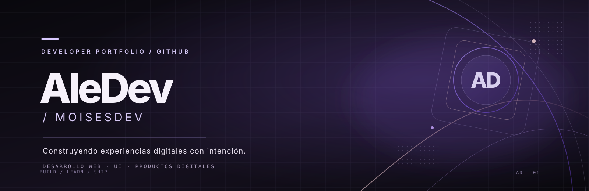

  

  <strong>Desarrollo web · Interfaces · Productos digitales</strong> 
  Construyo proyectos web combinando diseño, funcionalidad y aprendizaje continuo.

  <a href="https://github.com/AleeAJ">GitHub</a>
  &nbsp;·&nbsp;
  <a href="https://littlewatss.vercel.app">LittleWatts — demo</a>
  &nbsp;·&nbsp;
  <a href="https://TU-PORTAFOLIO-VERCEL.vercel.app">Portfolio personal</a>

---

## Sobre mí

Soy **AleDev / MoisesDev**, desarrollador web en formación. Me gusta transformar ideas en experiencias digitales claras, cuidar los detalles de interfaz y aprender construyendo proyectos reales.

Actualmente estoy enfocado en desarrollo frontend, experiencia de usuario e integración de funcionalidades para aplicaciones web.

## Proyectos destacados

<table>
  <tr>
    <td width="50%" valign="top">
      <h3>01 · LittleWatts</h3>
      
<strong>Prototipo de tienda digital de moda urbana.</strong>

      
Un prototipo web para presentar la identidad de una marca de moda urbana y una experiencia inicial de catálogo. La versión publicada es una demo en Vercel; sigue en desarrollo y no se presenta como una tienda de producción terminada.

      
<a href="https://littlewatss.vercel.app">Ver demo ↗</a>

    </td>
    <td width="50%" valign="top">
      <h3>02 · VexWard</h3>
      
<strong>Concepto de control de acceso inteligente.</strong>

      
Proyecto orientado a comunidades residenciales, con flujos de acceso mediante QR, pases de visita y comunicación en tiempo real. Las demostraciones deben usar datos ficticios, nunca información real de residentes.

      
<a href="https://github.com/AleeAJ/VexWardRepository">Ver repositorio público ↗</a>

    </td>
  </tr>
  <tr>
    <td colspan="2" valign="top">
      <h3>03 · Portfolio personal</h3>
      
<strong>Mi espacio personal para presentar proyectos y evolución.</strong> Actualmente en construcción; el repositorio de trabajo se mantiene privado mientras preparo la versión pública.

    </td>
  </tr>
</table>

## Stack & herramientas

<strong>FRONTEND & UI</strong>

  

<strong>BACKEND & WORKFLOW</strong>

  

  
  
  
  
  
  

Stack documentado en el repositorio público de VexWard. Las tecnologías se presentan como herramientas presentes en proyectos y prototipos, no como certificaciones ni como un nivel de dominio.

## En lo que estoy trabajando

- Mejorar la experiencia visual y funcional de **LittleWatts**.
- Seguir desarrollando y documentando **VexWard** con datos de prueba ficticios.
- Construir mi **portfolio personal** como punto central de mis proyectos.

---

  Diseñado con una estética oscura, violeta y lavanda · AleDev / MoisesDev

<!-- Antes de publicar:
1. Reemplaza https://TU-PORTAFOLIO-VERCEL.vercel.app por la URL pública real de tu portfolio.
2. Comprueba que https://littlewatss.vercel.app sea el dominio correcto de LittleWatts.
3. Mantén este README y assets/aledev-banner.svg dentro del repositorio público AleeAJ/AleeAJ.
4. No añadas tokens, claves, correos privados, datos reales de residentes ni información de repositorios privados.
-->
