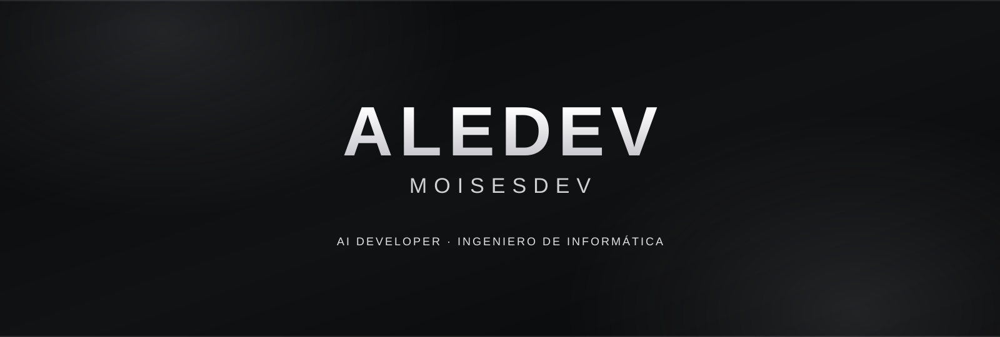

  

  <a href="https://github.com/AleeAJ">GITHUB</a>
  &nbsp;·&nbsp;
  <a href="https://littlewatss.vercel.app">LITTLEWATTS — DEMO EN VERCEL</a>

---

## Sobre mí

Soy **AleDev / MoisesDev**, desarrollador web en formación. Me interesa transformar ideas en experiencias digitales claras, cuidar los detalles de interfaz y aprender construyendo proyectos reales.

Actualmente estoy enfocado en desarrollo frontend, experiencia de usuario e integración de funcionalidades para aplicaciones web.

## Proyectos destacados

<table>
  <tr>
    <td width="50%" valign="top">
      <h3>01 · LittleWatts</h3>
      
<strong>Prototipo de tienda digital de moda urbana.</strong>

      
Proyecto en evolución para explorar una identidad de marca y una experiencia de catálogo online. La versión publicada es una demo en Vercel; se presenta como prototipo y no como una tienda de producción terminada.

      
<a href="https://littlewatss.vercel.app">Ver demo ↗</a>

    </td>
    <td width="50%" valign="top">
      <h3>02 · VexWard</h3>
      
<strong>Concepto de control de acceso inteligente.</strong>

      
Proyecto orientado a comunidades residenciales, con flujos de acceso mediante QR, pases de visita y comunicación en tiempo real. Las demostraciones deben usar datos ficticios, nunca información real de residentes.

      
<a href="https://github.com/AleeAJ/VexWardRepository">Ver repositorio público ↗</a>

    </td>
  </tr>
  <tr>
    <td colspan="2" valign="top">
      <h3>03 · Portfolio personal</h3>
      
<strong>Mi espacio para presentar proyectos y evolución.</strong>

      
Actualmente en construcción. El repositorio de trabajo se mantiene privado mientras preparo una versión pública.

    </td>
  </tr>
</table>

## Stack & herramientas

<strong>FRONTEND & UI</strong>

  

<strong>BACKEND & WORKFLOW</strong>

  

  

Iconos ampliados para facilitar su lectura. Tecnologías presentes en mis proyectos y prototipos; no representan certificaciones ni un nivel de dominio.

## En desarrollo

- Mejorar la experiencia visual y funcional de **LittleWatts**.
- Seguir desarrollando y documentando **VexWard** con datos de prueba ficticios.
- Construir mi **portfolio personal** como punto central de mis proyectos.

---

  AleDev / MoisesDev · BUILD / LEARN / CREATE

